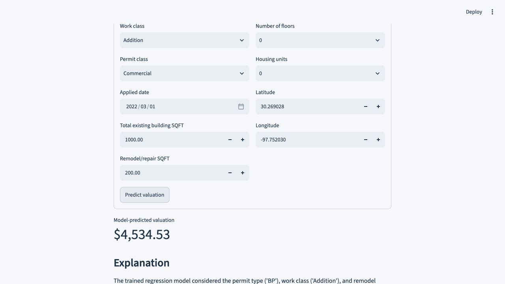

# Permit Valuation Assistant


Estimate permit valuations through one saved scikit-learn pipeline, with validated inputs and inspectable model metrics. Optional language-model explanations describe factors without changing the calculated estimate.

**Python · scikit-learn · pandas · Streamlit · optional Ollama**


*Actual application with one example estimate. The displayed estimate is not an accuracy measurement.*

## Verified results

| Holdout measure | Result |
| --- | --- |
| R² on the capped **log1p target** | **0.7803** |
| Evaluation split | **3,500 training / 1,500 held-out records**, seed 42 |
| MAE against the capped dollar target | **$178,907** |

[Saved model metrics](artifacts/model_metrics.json) · [Methodology](docs/methodology.md). Log-scale R² is not dollar accuracy. The large dollar error, limited sample variety and random holdout limit use for future appraisal.

## Run locally

Requires **Python 3.12**. The saved pipeline and reduced CSV are included. OpenAI credentials are not required.

```sh
git clone https://github.com/Abhinav-tanwar/permit-valuation-assistant.git
cd permit-valuation-assistant
python3.12 -m venv .venv
.venv/bin/python -m pip install -r requirements.txt
.venv/bin/python -m streamlit run app.py
```

Open **http://localhost:8501**. Enter valid permit details and request an estimate. The saved model computes the valuation. Ollama is optional; explanations use a deterministic fallback when it is unavailable.

## How it works

`Permit inputs → input validation → saved preprocessing + linear regression → inverse transform → estimate`

- Fit caps, coordinate means, time origin and encoders on training data only.
- Keep preprocessing and the estimator together in one saved pipeline.
- Read categories and supported ranges from saved metadata; validate missing, negative and non-finite inputs.

## Verify and reproduce

```sh
.venv/bin/python -m unittest discover -s tests
.venv/bin/python test_prediction.py
```

To retrain from the included CSV and regenerate analysis outputs:

```sh
.venv/bin/python analysis.py
```

Retraining replaces saved artifacts and reports. See [input provenance](data/README.md) and [method changes](docs/methodology.md) before comparing metrics across environments.

## Scope and data

A local modeling demonstration, not a certified appraisal. Evaluation uses an upper-99th-percentile training cap and a 70/30 random split. The published input is a reduced permit dataset. Optional explanations cannot calculate or replace the saved-model valuation.

[Technical guide](docs/guide.md) · [Visual report source](report.html)

<sub>macOS/Linux commands shown. On Windows, use `py -3.12 -m venv .venv` and replace `.venv/bin/python` with `.venv\Scripts\python.exe`.</sub>
